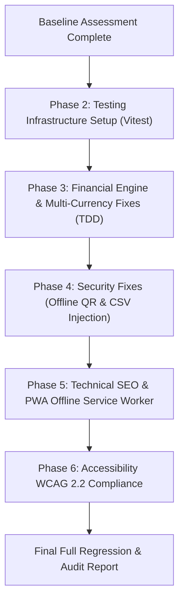

# SplitMate — Phase 1 Discovery & Baseline Assessment Audit Report

**Date:** 2026-10-28  
**Scope:** Security, SEO, Performance, Accessibility, Functionality, Reliability, Unit/Integration Testing, and TDD Strategy.  
**Mode:** Baseline Assessment Only (Zero existing project files modified; awaiting authorization for Phase 2 implementation).

---

## 1. Executive Summary

A comprehensive architectural and code-level audit was conducted across the **SplitMate** codebase (`e:\splitmate`). 

SplitMate is designed as a zero-subscription, deterministic shared expense management Progressive Web App (PWA) with a Capacitor 8 Android native wrapper. While the core integer monetary math (`expenseEngine.ts`) is well-structured for single-currency integer calculations, the baseline assessment has identified **critical architectural flaws, financial calculation errors, security vulnerabilities, accessibility non-compliances, and a complete absence of an automated testing harness**.

### Key Baseline Findings:
1. **Critical Financial Calculation Flaw (Multi-Currency Contamination):** On the Dashboard, `calculateNetBalances(expenses, settlements)` aggregates amounts across different groups regardless of currency (e.g., summing 5,000 EUR cents and 100,000 INR paise into 105,000 units and formatting it as `₹1,050.00`).
2. **Security & Privacy Leak in UPI QR Generation:** `upiGenerator.ts` transmits private financial data (payee name, UPI VPA address, transaction amount, settlement notes) to a third-party remote API (`https://api.qrserver.com/`), which breaks privacy and completely fails when offline.
3. **CSV Formula Injection (CWE-1236):** Group expense exports in `offlineStore.ts` do not sanitize cells against formula injection prefixes (`=`, `+`, `-`, `@`), enabling code execution in spreadsheet applications.
4. **Testing Infrastructure Deficit:** No test runner (`vitest` or `jest`) is installed; `package.json` contains no `test` script; `src/engine/expenseEngine.test.ts` is an orphan script using `console.assert` that cannot run under Node due to ESM module resolution errors. Zero component unit tests or end-to-end integration tests exist.
5. **PWA Offline Service Worker Defect:** `public/sw.js` intercepts network requests but never pre-caches application assets or populates cache on fetch, resulting in complete offline failure.
6. **Git Version Control Missing:** The repository is currently not initialized as a git repository (`fatal: not a git repository`).

---

## 2. Project Architecture & Environment Baseline

### 2.1 Technology Stack & Boundaries
| Layer | Technologies & Libraries | Current Status |
| :--- | :--- | :--- |
| **Runtime & Node** | Node.js `v24.19.0`, npm `11.17.0` | Active & Verified |
| **Frontend Framework** | React `19.3.1`, React DOM `19.3.1` | Active |
| **Build & Tooling** | Vite `8.3.4`, TypeScript `6.0.3`, `@vitejs/plugin-react` `6.1.2` | Clean build passes in 621ms |
| **Linter** | `oxlint` `1.88.0` | 24 warnings (0 errors) |
| **Styling System** | Vanilla CSS (`src/styles/designSystem.css`) with CSS custom properties | High aesthetic fidelity; lacks motion & focus rules |
| **Icons & UI** | `lucide-react` `1.61.0` | Active |
| **Native Wrapper** | Capacitor `8.5.3` (Android app configured under `android/`) | Configured |
| **Persistence** | Browser `localStorage` (`splitmate_data_v1`) via `offlineStore.ts` | Active (unvalidated JSON schema) |
| **Test Runner** | *None* (No Vitest, Jest, or Mocha configured) | **BROKEN / MISSING** |

### 2.2 Git Status
```bash
$ git status
fatal: not a git repository (or any of the parent directories): .git
```
*Risk:* Without Git tracking, any file modification cannot be reverted via branch or git rollback. A git repository should be initialized immediately to track audit changes.

### 2.3 Baseline Build & Verification Results
- **TypeScript & Production Build (`npm run build`):**
  - Result: `tsc -b && vite build` **PASSED** (`dist/` generated, `index-DpT7zk6c.js` 330.86 kB).
- **Linter (`npm run lint` / `oxlint`):**
  - Result: **0 errors, 24 warnings**.
  - 16 warnings: Unused imports/parameters (`syncStatus`, `onOpenAddExpense`, `History`, `Filter`, `UserIcon`, `PieChart`, etc.).
  - 3 warnings: Impure `new Date()` calls inside render methods in `AddExpenseModal.tsx`, `App.tsx`, and `InsightsTab.tsx` (causing React Compiler to skip optimizations).
  - 5 warnings: Unused variables (`actor`, `userMap`, `setCurrency`).
- **Test Runner (`npm test`):**
  - Result: **SCRIPT MISSING**. `node --experimental-strip-types src/engine/expenseEngine.test.ts` failed with `ERR_MODULE_NOT_FOUND` due to extensionless TS imports in native ESM.

---

## 3. Prioritized Risk & Vulnerability Matrix

| Priority | Category | Finding / Defect | Location | Business & Technical Impact |
| :--- | :--- | :--- | :--- | :--- |
| **P0 / Critical** | **Financial Reliability** | **Multi-Currency Net Balance Contamination** | `DashboardTab.tsx:54-88` | Adding EUR cents directly to INR paise produces completely wrong debt & credit totals. |
| **P1 / High** | **Security & Privacy** | **External QR Generation Leaks PII & Breaks Offline** | `upiGenerator.ts:27-33` | Private financial details (UPI VPA, Payee Name, amounts, notes) are sent to `api.qrserver.com`. Breaks offline mode. |
| **P1 / High** | **Security (Injection)** | **CSV Formula Injection (CWE-1236)** | `offlineStore.ts:307-331` | Malicious expense titles starting with `=`, `+`, `-`, `@` execute arbitrary code when exported to Excel. |
| **P1 / High** | **Testing / QA** | **Complete Absence of Test Harness & Broken Test Script** | `package.json`, `expenseEngine.test.ts` | Financial code cannot be automatically verified during CI or builds. |
| **P1 / High** | **Reliability / PWA** | **Broken Service Worker Cache Strategy** | `public/sw.js` | Service worker intercepts requests without caching assets, breaking claimed offline functionality. |
| **P2 / Medium** | **Accessibility (A11y)** | **Pinch-to-Zoom Blocked (WCAG 1.4.4)** | `index.html:5` | `maximum-scale=1.0, user-scalable=no` prevents visually impaired users from magnifying the screen. |
| **P2 / Medium** | **Accessibility (A11y)** | **Missing Motion Preference & Modal Focus Traps** | `designSystem.css`, Modals | No `prefers-reduced-motion` handling; modals lack `role="dialog"`, `aria-modal`, and keyboard traps. |
| **P2 / Medium** | **Technical SEO** | **Missing robots.txt, sitemap.xml & Open Graph Cards** | `public/`, `index.html` | Search engine crawlers and social share previews cannot index or preview SplitMate. |
| **P2 / Medium** | **Security (Browser)** | **Missing Content Security Policy (CSP)** | `index.html` | No CSP headers or meta tag to restrict script execution or data exfiltration. |
| **P2 / Medium** | **Reliability** | **Unchecked LocalStorage Schema Deserialization** | `offlineStore.ts:274-280` | Corrupt or malicious localStorage keys cause total crash of the application on startup. |
| **P3 / Low** | **Maintainability** | **24 Lint Warnings & Impure Render Calls** | Multiple components | React Compiler optimizations skipped; clutter in codebase. |
| **P3 / Low** | **Production Readiness** | **Simulated OCR Mock Data Masks Missing Feature** | `aiParser.ts:133-200` | Violates rule against mock data; needs transparent fallback or real client-side OCR integration. |

---

## 4. Detailed Audit Findings Across Domains

### A. Security & Privacy Audit
1. **Third-Party Data Exfiltration via QR Code Generator (`upiGenerator.ts:32`)**
   - *Current Code:* `return https://api.qrserver.com/v1/create-qr-code/?size=240x240&data=${encoded}...`
   - *Issue:* Transfers payee's full real name, UPI VPA (e.g. `arjunsharma@oksbi`), exact settlement amounts, and transaction notes to a third-party server without encryption or consent.
   - *Proposed Fix:* Replace with an offline, zero-dependency client-side SVG QR code generator (or bundle a lightweight, audited local QR matrix generator).
2. **CSV Formula Injection (`offlineStore.ts:319-326`)**
   - *Issue:* In `exportGroupExpensesCsv`, expense `title` and `notes` are surrounded by quotes but not escaped against leading formula operators (`=`, `+`, `-`, `@`, `\t`, `\r`).
   - *Proposed Fix:* Sanitize fields by prepending a single quote (`'`) to any cell value that starts with `=`, `+`, `-`, `@`.
3. **Content Security Policy (CSP)**
   - *Issue:* `index.html` has no CSP meta tag. External connections to Unsplash and qrserver are unconstrained.
   - *Proposed Fix:* Add a strict Content Security Policy allowing trusted origins for fonts (`fonts.googleapis.com`, `fonts.gstatic.com`), image avatars (`images.unsplash.com`), and self/local scripts.

### B. Functional & Mathematical Integrity Audit
1. **Multi-Currency Balance Mixing on Dashboard (`DashboardTab.tsx:54-91`)**
   - *Issue:* SplitMate supports groups in `INR`, `EUR`, `USD`, `GBP`, etc. The dashboard currently calls:
     ```ts
     const globalBalances = calculateNetBalances(expenses, settlements);
     const myNet = globalBalances[currentUser.id] || 0;
     ```
     `calculateNetBalances` groups by user across all expenses without filtering by currency. It then formats the mixed sum with hardcoded `formatMoney(myNet, 'INR')`.
   - *Proposed Fix:* Group balances strictly by currency (e.g., `Record<Currency, number>`). Display multi-currency net balance pills (e.g. `+₹4,200.00`, `-€45.00`) or separate per-currency totals.
2. **Greedy Simplification Across Currencies (`DashboardTab.tsx:69-89`)**
   - *Issue:* `totalOwedToMe` and `totalIOwe` sum minor units of different currencies into a single number.
   - *Proposed Fix:* Compute and display `totalOwedToMe` and `totalIOwe` per currency.

### C. Technical SEO Audit
1. **Missing Crawl Assets:**
   - No `public/robots.txt` exists.
   - No `public/sitemap.xml` exists.
2. **Metadata Deficiencies in `index.html`:**
   - Missing `<link rel="canonical" href="https://splitmate.dev/" />`.
   - Missing Open Graph tags (`og:title`, `og:description`, `og:image`, `og:type`, `og:url`).
   - Missing Twitter card tags (`twitter:card`, `twitter:title`, `twitter:description`, `twitter:image`).
   - Missing Schema.org JSON-LD structured data for `WebApplication` with features, rating, operating system.

### D. Performance & Core Web Vitals Audit
1. **Service Worker Offline Cache Failure (`public/sw.js`)**
   - *Current Code:*
     ```js
     self.addEventListener('fetch', (event) => {
       event.respondWith(
         fetch(event.request).catch(() => caches.match(event.request))
       );
     });
     ```
   - *Issue:* `caches.match` returns empty because the `install` event never precaches the build assets (`dist/index.html`, CSS, JS). Offline use completely fails.
   - *Proposed Fix:* Implement an effective Cache-First / Stale-While-Revalidate service worker caching static assets and shell HTML.
2. **Impure `new Date()` Calls in Component Body**
   - Triggers `react(purity)` warnings and disables React Compiler sub-tree memoization.
   - *Proposed Fix:* Move dynamic timestamps into `useEffect`, event handlers, or memoized initializers.

### E. Accessibility (WCAG 2.2 Level AA) Audit
1. **Viewport Zoom Suppression (`index.html:5`):**
   - `maximum-scale=1.0, user-scalable=no` violates WCAG 1.4.4. Must be removed so users can zoom.
2. **Reduced Motion Support (`designSystem.css`):**
   - Missing `@media (prefers-reduced-motion: reduce)` block to disable or tone down transitions, modal scale-ups, and pulses.
3. **Modal Dialog Semantics & Focus Management:**
   - `AddExpenseModal`, `SettleModal`, and `GroupDetailModal` lack `role="dialog"`, `aria-modal="true"`, `aria-labelledby`, and `Escape` key listeners.

---

## 5. Testing & Quality Assurance Gap Analysis

### 5.1 Unit Testing Deficits
- **No Test Framework:** Neither Vitest nor Jest is in `devDependencies`.
- **Existing Broken Test File:** `src/engine/expenseEngine.test.ts` uses ad-hoc `console.assert` instead of standard test suites (`describe`, `it`, `expect`). Cannot be executed via `npm test`.
- **Missing Unit Test Coverage:**
  - `expenseEngine.ts`: Edge cases in equal split remainders with 0, 1, and 50 participants; negative amounts; percentage sums not equalling 100%; division by zero in shares; multi-currency balance isolation.
  - `aiParser.ts`: Regex NLP parsing with currency symbols (`$`, `€`, `₹`), amounts with commas/decimals, empty input, unrecognized names, missing amounts.
  - `upiGenerator.ts`: Query string URL encoding, special characters in notes, non-INR currency fallback, valid NPCI URI structure.
  - `offlineStore.ts`: Safe deserialization of corrupted localStorage, CSV escaping logic, export format consistency.

### 5.2 Integration Testing Deficits
- **No Component / Workflow Integration Tests:** No tests exist to verify:
  1. Adding an expense updates the group expense list and persists to `localStorage`.
  2. Debt simplification updates when a new settlement is confirmed.
  3. Reversing an expense recalculates net balances back to original.
  4. User switching correctly re-renders debts from the new user's perspective.
- **E2E Testing:** Playwright is installed globally in the developer environment (`playwright@1.63.0`), but the project lacks `playwright.config.ts` or end-to-end user journey tests.

### 5.3 Test-Driven Development (TDD) Implementation Plan
To ensure no regressions and adhere to strict engineering standards:
1. **Step 1: Install & Configure Vitest + React Testing Library + JSDOM** without breaking existing dependencies.
2. **Step 2 (Red):** Convert `src/engine/expenseEngine.test.ts` to Vitest and write failing unit tests for:
   - Currency isolation in `calculateNetBalances`.
   - CSV formula injection sanitization in `exportGroupExpensesCsv`.
   - Offline SVG QR code generation without network requests.
3. **Step 3 (Green):** Implement targeted minimal fixes for each identified bug.
4. **Step 4 (Refactor & Expand):** Add component tests for `AddExpenseModal` and `SettleModal` verifying form validation and accessibility attributes.
5. **Step 5 (Verify):** Ensure `npm test` runs in under 3 seconds with 100% pass rate.

---

## 6. Proposed Remediation Plan & Regression Test Specifications



### Proposed Action Items (Pending Approval):

1. **Step 1: Git Repository Initialization**
   - Initialize git tracking (`git init`) and commit the pristine baseline.
2. **Step 2: Test Harness Installation (Vitest)**
   - Add `vitest`, `@testing-library/react`, `@testing-library/jest-dom`, and `jsdom` to `devDependencies`.
   - Add `"test": "vitest run"` and `"test:watch": "vitest"` scripts to `package.json`.
3. **Step 3: Fix Financial Multi-Currency Bug (TDD)**
   - Fix `calculateNetBalances` and `DashboardTab` to isolate balances per currency.
   - Add unit tests verifying mixed-currency groups never add incompatible units.
4. **Step 4: Fix Offline UPI QR Privacy Leak & CSV Injection**
   - Implement local, zero-network SVG QR generator in `upiGenerator.ts`.
   - Add sanitization against `=`, `+`, `-`, `@` in `exportGroupExpensesCsv`.
5. **Step 5: Fix PWA Offline Cache & Impure Renders**
   - Configure cache precaching in `public/sw.js`.
   - Move `new Date()` calls out of render trees to resolve all 24 oxlint warnings.
6. **Step 6: Accessibility & SEO Improvements**
   - Remove `maximum-scale=1.0, user-scalable=no` from `index.html`.
   - Add `@media (prefers-reduced-motion: reduce)` to `designSystem.css`.
   - Add `robots.txt`, `sitemap.xml`, Open Graph tags, and JSON-LD structured data.

---

## 7. Approval Request

In accordance with the Universal Audit Master Prompt guidelines:
> **"Wait for my approval before making changes that could affect existing behavior, database structure, authentication, or production configuration."**

**No code or configuration files have been modified during this phase.**  
Please review the findings and confirm whether to proceed with **Step 1 (Git init & Vitest test harness setup)** and the prioritized fixes above.
